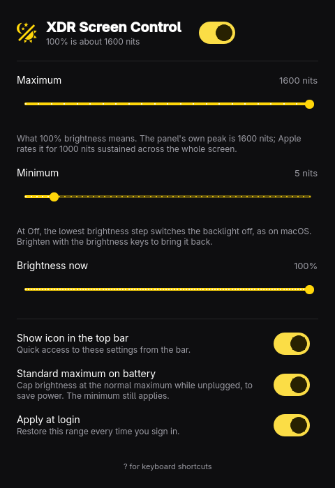

# XDR Screen Control

Extended brightness for the built-in mini-LED display of Apple Silicon
MacBook Pros running [Omarchy](https://omarchy.org) on the `linux-aurora`
kernel. Linux stops at about 500 nits on these panels; this raises the ceiling
to the panel's 1600-nit peak, lets you choose the range the brightness keys
cover, and lets the lowest step switch the backlight off like macOS does.

What it does **not** do: HDR content does not work. See
[docs/research.md](docs/research.md) for what was tried and where it stands.

<p align="center"></p>

## Status

- **Tested on one machine:** MacBook Pro 14" M1 Pro (`apple,j314s`), Omarchy
  4.5.0, `linux-aurora` 7.2.11, display firmware 13.5. The kernel module refuses
  other firmware versions. Other Macs may work, but nobody has tried.
- **Brightness above 500 nits works** and survives reboots. Levels were judged
  by eye; nothing was measured with a light meter. The number you choose is the
  request sent to the firmware, not a measured luminance.
- **HDR playback does not work** yet.

## Install

```bash
bin/install
```

Builds an Arch package and installs it with pacman (asks for sudo). You get
**XDR Screen Control** in the app launcher, the `omarchy-xdr` command, and a
kernel module that is built for the running kernel and loaded at every boot
(`omarchy-xdr-probe.service`). It needs `linux-aurora-headers`, `pahole`, `gcc`
and `make`. `sudo pacman -R xdr-screen-control` removes it.

## Using it

- **Switch:** turns the extended range on or off. Off is stock behaviour.
- **Maximum:** what 100% brightness means, 500 to 1600 nits.
- **Minimum:** the bottom of the scale. At *Off* the lowest brightness step
  (1%, the floor of the brightness keys) switches the backlight off, as on
  macOS; brighten with the keys to bring it back. Otherwise it is that many
  nits.
- **Standard maximum on battery:** while unplugged, the top of the range drops
  to the stock maximum (about 504 nits); the minimum still applies.
- **Show icon in the top bar:** adds or removes the bar widget.
- **Apply at login:** restores your choice after a reboot.

The brightness keys and sliders keep working as before, now across the range
you chose. The same from a terminal:

```bash
omarchy-xdr enable | disable | max 1200 | min 0 | battery on | bar on | autostart on | status
```

**Risks.** Apple rates this panel for 1000 nits sustained across the whole
screen and 1600 only for small highlights. Under Linux the firmware gets a
constant fake panel temperature, so its thermal protection may not work. Holding
the whole screen above 1000 nits for long is at your own risk. A frame
submission the firmware rejects can crash the display coprocessor and freeze
the screen until reboot; the module writes nothing to disk, so a reboot undoes
everything.

## How it works

The display is driven by a coprocessor (DCP). Linux asks it for a brightness by
putting a number in each frame submission. The kernel driver only ever sends
values from a table that ends at 510 nits, and the device tree says 500. The
number is a small floating-point value (`nits = 2^(e+1) * (1 + f)`), and the
firmware accepts values far above the table. `apple_xdr_probe` is a kernel
module that hooks the driver's message send function with a kprobe and rewrites
that field, so no driver rebuild is needed. Structure offsets are read from the
running kernel's BTF at build time. Details and measurements:
[docs/research.md](docs/research.md).

## What is here

| Path | What it is |
| --- | --- |
| `src/`, `xdr-screen-control.pro` | The app (Qt Quick). |
| `plugin/xdr.brightness/` | The top-bar widget. |
| `bin/omarchy-xdr` | Saved preferences and the command that applies them. |
| `probe/` | `apple_xdr_probe`, the kernel module. Also a research tool: it can retag surfaces as PQ, patch other bytes of a frame submission and read back what the firmware reports. |
| `system/`, `pkgbuild/` | Boot-time loader, systemd units, Arch package. |
| `bin/xdr-probe`, `bin/xdr-experiment`, `bin/xdr-hdr-test` | Research scripts for the module. |
| `docs/` | Findings and experiment logs. |

## Licence

The kernel module (`probe/`, `system/`) is GPL-2.0-only, like the driver it
hooks. The app and scripts are MIT. See `LICENSE`.
